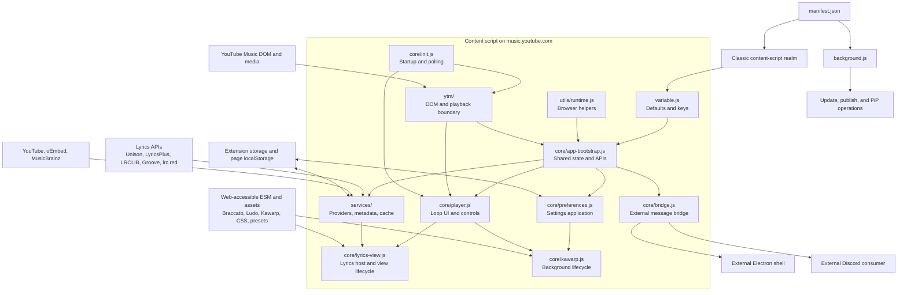
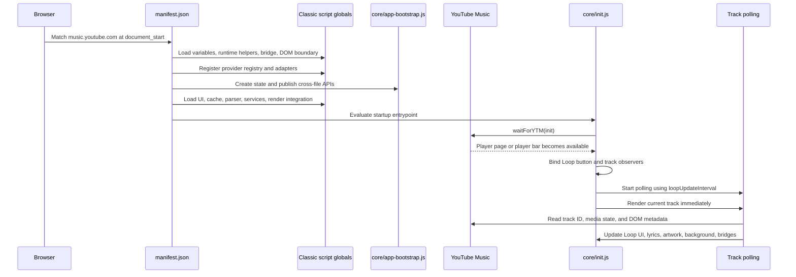
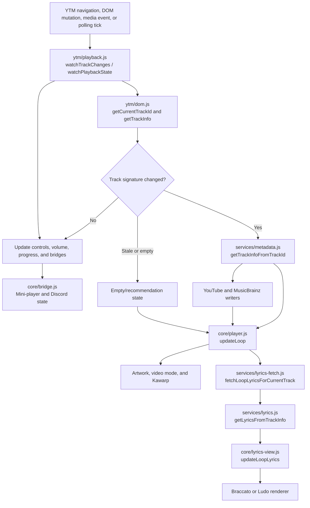
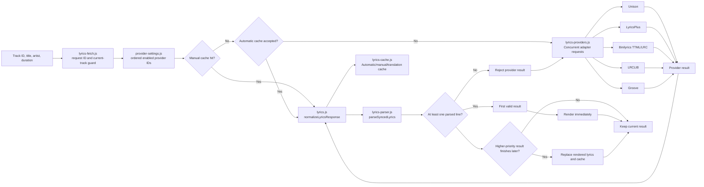
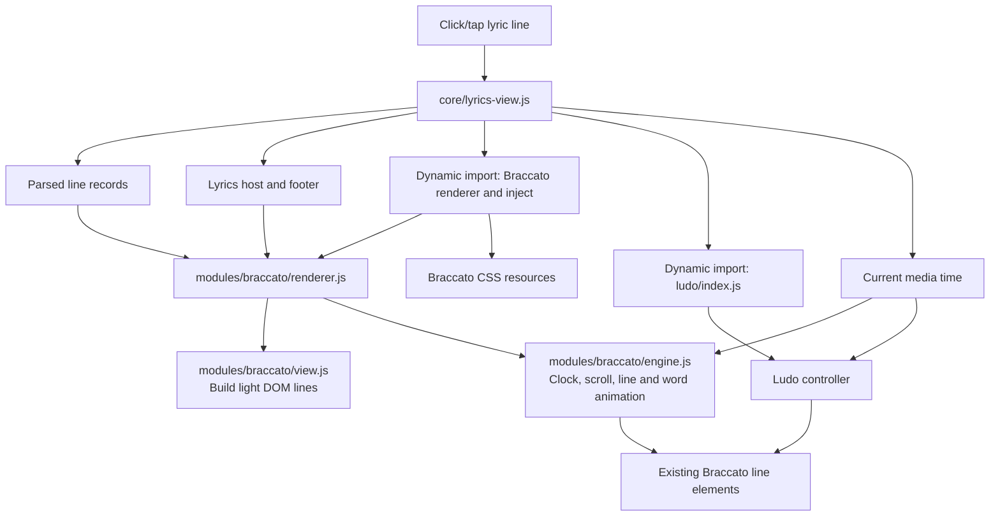
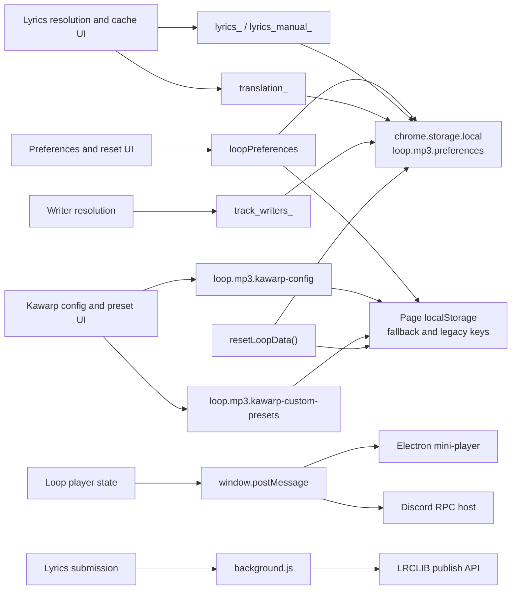

# Loop Project Map

This file is the maintainer and coding-agent guide for the current Loop repository. It is intentionally implementation-focused: when this document disagrees with source, `manifest.json` and the source win.

## Current shape

Loop is a Manifest V3 browser extension that replaces the normal YouTube Music player view with a keyboard-first Loop UI. The extension runs on `https://music.youtube.com/*`, uses classic content scripts loaded in a strict order, and has no build or bundling step.

Current package version: `0.8.1` (see `manifest.json`). The project is primarily browser code, with Node-based tests that load individual classic scripts inside `vm` contexts.

Important architectural facts:

- `manifest.json` is the content-script dependency graph. Do not reorder its `js` array casually.
- The content scripts are classic scripts, not ES modules. Lexical bindings are not a cross-file API.
- Files explicitly publish cross-file functions and state on `globalThis` through names such as `LoopVariables`, `LoopUtils`, `LoopYtmDom`, `LoopCore`, and `LoopLyricsProviderAdapters`.
- `core/init.js` starts the application. `index.js` is deliberately only a small marker file loaded last.
- Braccato, Ludo, and Kawarp are loaded with dynamic `import()` and therefore must remain web-accessible resources.
- YouTube Music DOM selectors are fragile integration points. Keep selector-specific work in `ytm/` where possible.

## Repository tree

Only the important source boundaries are listed below. `node_modules/` and `.codex_tmp/` are local/ignored material, not extension source.

```text
loop/
├── manifest.json              MV3 metadata, permissions, load order, web resources
├── index.js                   Intentionally small final content-script marker
├── variable.js                Defaults, provider definitions, storage keys, constants
├── background.js              Extension background entrypoint
├── package.json               Node test command and runtime dependencies
├── README.md                  Minimal product README and preview image
├── CHANGELOG.md               Release notes; onboarding fetches this remotely
│
├── core/                      Loop application state, UI, integrations, startup
│   ├── app-bootstrap.js       State initialization and cross-file API publishing
│   ├── bridge.js              Electron mini-player and Discord message bridge
│   ├── dialogs.js              Reset and lyrics-submission modals
│   ├── init.js                Startup, update notice, favicon, navigation cleanup
│   ├── kawarp.js              Kawarp loading, presets, video background, notices
│   ├── lyrics-view.js         Braccato view, lyrics footer, translation, rendering
│   ├── onboarding.js          Versioned onboarding and update checks
│   ├── player.js              Loop DOM, menu, preferences UI, main update routine
│   ├── preferences.js         Preferences application and presentation modes
│   └── provider-settings.js   Provider ordering, enable/disable/remove UI
│
├── services/                  Network, caching, metadata, and lyrics resolution
│   ├── binilyrics.js           lrc.red TTML/LRC adapters
│   ├── groove.js               Groove and Groove dev adapters
│   ├── lrclib.js               LRCLIB search and candidate adapter
│   ├── lyrics-cache.js         Preferences, lyrics, translation, writer caches
│   ├── lyrics-fetch.js         Current-track fetch lifecycle and stale-result guards
│   ├── lyrics.js               Normalization and concurrent provider resolution
│   ├── lyricsplus.js            LyricsPlus adapter and TTML conversion
│   ├── lyrics-providers.js     Provider registry and candidate fan-out
│   ├── metadata.js              YouTube metadata, writers, MusicBrainz, recommendations
│   └── unison.js                Unison adapter
│
├── ytm/                       YouTube Music DOM and playback boundary
│   ├── dom.js                  Selectors, track IDs, artwork, basic track info
│   ├── playback.js             Media controls, track observation, track updates
│   ├── player.js               Record button, PiP mini-player, sleep, auth, actions
│   └── search.js               Loop search/queue panels and YTM restoration
│
├── utils/
│   ├── lyrics-parser.js        LRC, TTML, plain, instrumental, gap-note parsing
│   └── runtime.js              Extension URLs, HTML escaping, time formatting
│
├── modules/
│   ├── kawarp.js               WebGL Kawarp renderer, imported dynamically
│   └── braccato/               Vendored ESM lyrics renderer and styles
│       ├── index.js             Public Braccato exports
│       ├── element.js           Braccato element integration helpers
│       ├── renderer.js         Renderer lifecycle and Braccato engine host
│       ├── engine.js            Playback clock, line/word animation, scrolling
│       ├── inject.js            Timed words, bidi text, translation/romanization
│       ├── view.js              Light-DOM lyric view construction
│       ├── imageHighlights.js   Instrumental image highlighting
│       ├── instrumental.js      Instrumental line elements and animation
│       ├── language.js          Lyric language resolution
│       ├── stage.js             Stage layout helpers
│       ├── seek.js              Lyric seek behavior
│       ├── text.js              Text helpers
│       ├── themeSettings.js     Theme settings
│       ├── constants.js         CSS/class constants
│       ├── types.js             Shared data shapes
│       ├── util.js              Renderer utilities
│       └── styles/              variables, lyrics, instrumental, stage, highlights CSS
│
├── ludo/                      Optional alternate lyric progression renderer
│   ├── index.js                ESM renderer/controller; depends on Braccato DOM
│   └── README.md               Ludo scope and warning
│
├── config/
│   ├── shader.json             Default Kawarp configuration
│   ├── config.md               Custom Kawarp preset guide
│   └── presets/                Bundled JSON presets and manifest
│
├── static/                    CSS, icons, artwork fallbacks, SVGs, preview assets
└── tests/                     Node test runner and web-ext lint coverage
```

## Runtime loading contract

The content script is injected at `document_start` on YouTube Music. The exact current order in `manifest.json` is:

```text
variable.js
utils/runtime.js
core/bridge.js
ytm/dom.js
services/lyrics-providers.js
services/groove.js
services/lyricsplus.js
services/unison.js
services/binilyrics.js
services/lrclib.js
core/app-bootstrap.js
core/provider-settings.js
core/onboarding.js
services/lyrics-cache.js
core/dialogs.js
core/preferences.js
ytm/player.js
utils/lyrics-parser.js
services/lyrics.js
core/lyrics-view.js
services/lyrics-fetch.js
core/kawarp.js
services/metadata.js
core/player.js
ytm/playback.js
ytm/search.js
core/init.js
index.js
```


The dependency phases are:

1. **Foundations:** `variable.js`, `utils/runtime.js`, `core/bridge.js`, and `ytm/dom.js` establish defaults, runtime helpers, integration transport, and the YouTube Music DOM boundary.
2. **Lyrics adapters:** the provider registry is created before each provider registers a factory in `LoopLyricsProviderAdapters`.
3. **Application state:** `core/app-bootstrap.js` creates mutable runtime state and publishes the API consumed by later scripts.
4. **UI and storage:** provider settings, onboarding, cache, dialogs, and preferences publish their functions.
5. **Playback and lyrics:** player controls, parser, lyrics resolution/view, metadata, and Kawarp are loaded before the main player update path.
6. **Startup:** `ytm/playback.js`, `ytm/search.js`, `core/init.js`, and finally `index.js` complete the runtime. `core/init.js` calls `waitForYTM(init)` and begins polling once YouTube Music exposes its player.

### Cross-file API rules

Because these are classic scripts, a function declared in one file is not a safe import for another file. A module that needs to expose an API must publish it explicitly, usually with an IIFE at the bottom:

```js
(function publishLoopModule(global) {
    global.somePublicFunction = somePublicFunction;
})(globalThis);
```

Existing shared namespaces include:

- `LoopVariables`: frozen defaults, provider definitions, keys, limits, and URLs from `variable.js`.
- `LoopUtils`: `getExtensionURL`, `escapeHTML`, and `formatTime` from `utils/runtime.js`.
- `LoopYtmDom`: YouTube Music DOM helpers from `ytm/dom.js`.
- `LoopCore.createBridge`: bridge factory from `core/bridge.js`.
- `LoopLyricsProviderAdapters`: provider adapter factories registered by provider files.
- `LoopLyricsServices.createLyricsProviderService`: provider registry factory.

Many older local functions are also published directly on `globalThis`; preserve those names when changing a consumer. Do not convert one content-script file to `import`/`export` without redesigning the whole load contract.

## Architecture maps

These diagrams describe the current runtime, not a proposed future architecture. Arrows mean either a dependency, a callback, or a message/data flow; the surrounding notes identify which one applies.

### 1. Runtime component map



**How to read it:** `ytm/` is the platform boundary, `core/` coordinates product behavior, `services/` owns network/data work, and `modules/`/`ludo/` are rendering dependencies rather than classic-script peers. The browser DOM and external APIs are outside Loop’s control; `core/app-bootstrap.js` is the internal state seam.

### 2. Script loading and startup sequence



The important ordering guarantee is that `core/init.js` runs only after the APIs it calls have been published. `index.js` is evaluated last but does not own startup. A new classic script must be inserted before its consumers, not merely added to the end of the manifest.

### 3. Track and playback lifecycle



**Lifecycle invariant:** the track ID/signature is the identity key for asynchronous work. Metadata, writer credits, lyrics, translations, and renderer updates must verify that identity before mutating the current `#loop` view.

### 4. Lyrics resolution map



The resolver is intentionally latency-oriented: providers run concurrently, the first parseable result can render, and a higher-priority provider may replace it later. `lyrics-fetch.js` is responsible for preventing that useful concurrency from becoming a stale-track bug.

### 5. Lyrics renderer layering



Braccato owns the line DOM and synchronization records. Ludo is an optional progression/animation layer over those records; it is not a second parser or an independent lyric DOM. Replacing the Braccato view requires destroying the old renderer before mounting a new one.

### 6. Persistence and integration map



Storage ownership matters: automatic lyrics, manual selections, translations, and writer records use extension storage; Kawarp configs and onboarding use page `localStorage`; the main preference object prefers extension storage but has a page-storage fallback. Reset is therefore a cross-store operation with data-loss implications.

### Boundary and ownership matrix

| Boundary | Primary owner | Contract | Typical failure mode |
| --- | --- | --- | --- |
| YouTube Music DOM | `ytm/dom.js`, `ytm/playback.js` | Selectors, media element, track identity | YTM markup changes or navigation race |
| Runtime globals | `variable.js`, `utils/runtime.js`, `core/app-bootstrap.js` | Published names and load order | Consumer runs before producer or assumes lexical sharing |
| Lyrics providers | `services/lyrics-providers.js` plus adapters | Provider ID, request context, normalized response | Network/CORS failure or unusable payload |
| Lyrics identity | `services/lyrics-fetch.js` | Current track ID and request ID | Late result replaces another track |
| Lyrics renderer | `core/lyrics-view.js`, Braccato, Ludo | Parsed lines, media clock, mount lifecycle | Old renderer remains alive or dynamic resource is inaccessible |
| Preferences/cache | `core/preferences.js`, `services/lyrics-cache.js` | Keys, defaults, normalization, reset semantics | Stale settings or accidental data clearing |
| External host bridge | `core/bridge.js` | `window.postMessage` types and state shape | Electron/Discord integration silently stops updating |
| Extension background | `background.js` | Runtime messages and external publish/update calls | Missing permission, sender tab, or remote service |

## Startup and application lifecycle

### Bootstrap and startup

`core/app-bootstrap.js` is the state boundary. It adapts `LoopYtmDom`, creates the Electron/Discord bridge, copies constants from `LoopVariables` into local bindings, and owns mutable runtime state such as:

- `loopPreferences` and `kawarpSettings`
- current artwork, track, writers, lyrics, provider, and request IDs
- Kawarp background and renderer state
- Braccato/Ludo renderer state
- polling and update-blocking state

`core/init.js` runs once YouTube Music is ready. It sets the page title, checks authentication, binds the Loop record button, starts track observation, renders the current track without waiting for the update check, starts polling, and handles the update notice. It also keeps Loop’s guide buttons and favicon changes from being undone by YouTube navigation.

`core/player.js` owns the `#loop` DOM tree and the large `updateLoop(artworkURL, trackInfo)` render/update path. It creates the menu, playback controls, artwork, lyrics host, search/queue panels, notifications, and preference controls. `core/preferences.js` applies settings to this DOM and to the current media/renderer.

### Track and playback lifecycle

`ytm/dom.js` is the selector boundary. It finds the current player root, resolves a YouTube track ID from the URL/player links, reads player-bar artwork, and returns basic byline information.

`ytm/playback.js` owns the media element and the track lifecycle:

- finds the current playable `<video>`/media element;
- updates Loop playback controls and volume/seek state;
- sends YouTube keyboard/action events for previous/next/mute/etc.;
- observes player-bar, media, and navigation changes;
- calls the metadata path when the track signature changes;
- keeps playback, lyrics, record motion, mini-player, and Discord state synchronized.

`ytm/player.js` adds the Loop record button, document Picture-in-Picture mini-player, optional mini-player Kawarp rendering, screen/sleep controls, like/dislike synchronization, and authentication warnings.

`ytm/search.js` temporarily replaces YTM search and queue surfaces with Loop panels and has explicit restoration functions. When changing search or queue behavior, verify both opening and restoration paths.

## Lyrics pipeline

The current pipeline is provider-driven and concurrent. The old single-provider implementation remains in `services/lyrics.js` as legacy reference code; new behavior should use the registry path.

### Providers and adapters

`variable.js` defines these providers and their default display order:

| ID | Label | Format / endpoint |
| --- | --- | --- |
| `unison` | Unison | `https://unison.boidu.dev` |
| `lyricsplus` | LyricsPlus | `https://lyricsplus.prjktla.my.id/v2/lyrics/get` |
| `binilyrics-ttml` | Binilyrics (lrc.red TTML) | `https://lrc.red`, TTML |
| `binilyrics-lrc` | Binilyrics (lrc.red LRC) | `https://lrc.red`, LRC |
| `lrclib` | LRCLIB | `https://lrclib.net/api/search` |
| `groove` | Groove | `https://groove.mizucode.qzz.io/api/v1/track` |
| `groove-dev` | Groove (dev) | `http://127.0.0.1:8787/api/v1/track` |

Each adapter file registers a factory in `LoopLyricsProviderAdapters`. `services/lyrics-providers.js` turns the definitions and factories into a service with provider lookup, one-provider requests, and candidate fan-out. Adapter factories receive shared dependencies such as `normalizeLyricsResponse`, timestamp validation, and preference access.

Provider-specific behavior includes:

- Unison tries a video-ID lookup first, then title/artist search and duration matching.
- LyricsPlus converts its timed line/syllable payload to TTML and can retry using the YouTube oEmbed author.
- Binilyrics searches for an ISRC, then fetches either TTML or LRC and validates the format.
- LRCLIB performs fallback searches, returns candidate results, skips lyrics that exceed track duration, and handles instrumental results.
- Groove uses the track ID and can request Groove overrides according to preferences.

When adding a provider:

1. Add its definition to `LoopVariables.lyricsProviders` and the desired default order if appropriate.
2. Add/register its adapter before `core/app-bootstrap.js` is evaluated.
3. Make its normalized response parseable by `utils/lyrics-parser.js`.
4. Add or update tests using the existing VM/fake-fetch pattern.
5. Consider provider settings, cache, manual selection, and the packaged extension’s network permissions/CORS behavior.

### Resolution and stale-result protection

`services/lyrics.js` normalizes provider payloads to:

```js
{
    meta: {
        provider,
        duration,
        instrumental,
        // provider-specific metadata is retained
    },
    syncedLyrics: string | null,
    plainLyrics: string | null,
}
```

`getLyricsFromTrackInfo()` follows this sequence:

1. Use manually selected lyrics for the track when present.
2. Use a valid cached result unless forced refresh or preference rules reject it.
3. Request enabled providers concurrently in the configured order.
4. Validate each response by parsing it; a nonempty but unparseable response is a failure.
5. Resolve the first valid result, then replace it if a higher-priority provider finishes later.
6. Cache the selected result and record the active provider.

`services/lyrics-fetch.js` wraps that resolver for the current UI. It tracks a request ID, track ID, in-flight request, and current parsed lyrics so a late response cannot replace lyrics for a different track or a disabled lyrics view. Forced refresh keeps an existing valid render until a replacement parses successfully.

`core/provider-settings.js` supports provider ordering, disabling, removal, restoration, and manual re-fetch. Removed provider IDs are excluded from display order; disabled IDs remain known but are excluded from requests.

### Parsing and rendering

`utils/lyrics-parser.js` parses:

- LRC line timestamps;
- inline LRC word timestamps such as `<00:21.57>`;
- TTML paragraphs and timed spans, including `xml:space="preserve"`;
- plain lyrics distributed over the known duration;
- instrumental placeholders;
- opening/closing lyric gaps as musical-note lines when the configured gap exceeds the threshold.

Parsed line records are shaped like:

```js
{
    startTimeMs,
    durationMs,
    words,
    parts: [{ startTimeMs, durationMs, words }], // when rich timing exists
}
```

`core/lyrics-view.js` dynamically imports `modules/braccato/renderer.js`, `modules/braccato/inject.js`, and `ludo/index.js`, then fetches the Braccato CSS files. It owns the lyrics host, loading/no-lyrics states, footer/provider selection, writer credits, Genius link, manual candidate selection, translation, and seek callbacks.

The standard renderer is Braccato. The optional `ludo` preference does not replace Braccato’s DOM or parser: Ludo animates the existing Braccato line elements and synchronization records. The Ludo README’s warning about this dependency is still accurate.

Translation uses the Unison translation endpoint, an in-memory pending-request map, extension storage cache keys, supported language normalization, and retry delays. Do not assume translation changes the source lyrics; it is applied to the rendered line data.

## Metadata and writers

`services/metadata.js` combines several sources:

- YouTube oEmbed and player/browse responses for canonical title, artist, album, video type, and URLs;
- YouTube browse data for writer credits when available;
- MusicBrainz recording/work relationships for composer and lyricist fallback;
- cached writer results to avoid repeated network calls;
- recommendation shelves/cards for the empty state.

YouTube metadata is returned before the asynchronous MusicBrainz writer promise necessarily finishes. Code consuming track metadata must tolerate `musicBrainzWriterPromise` resolving later and must re-check that the track has not changed before applying late writer results.

## Preferences and storage

Preferences use browser extension storage when available and fall back to page `localStorage` for the main preference object. The relevant keys and prefixes are defined in `variable.js`:

| Data | Key or prefix | Storage behavior |
| --- | --- | --- |
| Main preferences | `loop.mp3.preferences` | `chrome.storage.local`/`browser.storage.local`, then page `localStorage` fallback |
| Active Kawarp config | `loop.mp3.kawarp-config` | page `localStorage` |
| Custom Kawarp preset manifest | `loop.mp3.kawarp-custom-presets` | page `localStorage` |
| Automatic lyrics | `lyrics_` | extension storage only |
| Manual lyrics selection | `lyrics_manual_` | extension storage only |
| Translations | `translation_` | extension storage only |
| Writer credits | `track_writers_` | extension storage only |
| Onboarding | `<installed-version>IsOnboarded` | page `localStorage` |

Important preference groups include animated background, artwork/vinyl visibility, mini-player behavior, theme, volume, lyrics cache/translation, provider order and disabled/removed IDs, polling interval, Kawarp FPS, writer credits, and per-track `audio`/`video` presentation mode.

`services/lyrics-cache.js` also provides the cached-lyrics management UI, cache export/import, per-entry editing/removal, translation association, and writer entry inspection.

`resetLoopData()` clears extension local storage and Loop-owned legacy page-localStorage keys, restores defaults, invalidates lyrics work, and restarts polling. It intentionally does not clear unrelated page-localStorage keys, but extension storage clearing is broad; treat changes to reset behavior as data-loss-sensitive.

## Kawarp, artwork, and video behavior

`core/kawarp.js` dynamically imports `modules/kawarp.js`, loads `config/shader.json`, applies saved config, owns the canvas background, and manages preset UI and notifications. `modules/kawarp.js` exports the WebGL `Kawarp` class as its default export; it handles shader programs, blur/blend/tint/domain-warp passes, image transitions, FPS caps, and lifecycle (`start`, `stop`, `dispose`).

Kawarp settings are merged with defaults and can be enabled only when both the Kawarp setting and Loop’s animated-background preference allow it. Rendering stops while the document is hidden or when a video background is active. The same renderer can be synchronized to the document Picture-in-Picture mini-player.

Bundled presets live under `config/presets/`. The object in `config/presets/manifest.json` maps display names to exact filenames. To add a bundled preset, add its JSON file and update that manifest. Custom uploaded presets are stored locally because an installed extension cannot rewrite packaged files. See `config/config.md` for the supported format and `version: "2.0"` requirement.

Video presentation preferences are per-track and include automatic audio/video mode, video avoidance, and optional UI rearrangement. Changes can affect the player DOM and Kawarp visibility at the same time, so test both audio tracks and music-video tracks.

## Electron, Discord, and background integration

`core/bridge.js` keeps external transports out of player code. It posts `window` messages for:

- `loop:electron-kawarp-state`;
- `loop:electron-mini-player-state`;
- `loop:electron-open-mini-player` and `loop:electron-close-mini-player`;
- `loop:electron-mini-player-command`;
- `discord-rpc:update` and `discord-rpc:clear`.

The bridge deduplicates mini-player and Discord updates. `core/init.js` receives mini-player commands and forwards state to a host-provided `window.electronAPI` when available. The Electron shell and Discord consumer are external to this repository; preserve message names and state fields as public integration contracts.

`background.js` is the extension background entrypoint. It:

- checks the remote update configuration when the extension is installed;
- can open a sanitized update popup;
- handles current-tab closing;
- proxies lyrics publication to LRCLIB using a token supplied by the UI;
- can execute the Picture-in-Picture mini-player command in the sender tab.

The content-script update check in `core/onboarding.js` is a separate path used for in-page notices/blocking. Keep both paths in mind when changing update behavior.

## Manifest and resource rules

`manifest.json` currently declares:

- content scripts on `https://music.youtube.com/*` at `document_start`;
- `<all_urls>` host permission;
- `storage` and `scripting` permissions;
- `static/loop.css` as content CSS;
- bundled config, Kawarp, Braccato, Ludo, and fallback artwork as web-accessible resources;
- `background.js` as the background entrypoint;
- a Firefox Gecko ID.

When adding or moving a file:

- add classic runtime files to the manifest in dependency order;
- add dynamically imported files, CSS, or assets to `web_accessible_resources`;
- update `config/presets/manifest.json` for every bundled preset;
- review host permissions and external endpoints for least privilege and CORS behavior;
- preserve the no-build workflow unless the manifest and developer instructions are changed with it.

## Tests and validation

The repository now has automated tests. Install dependencies and run:

```sh
npm install
npm test
```

`npm test` runs Node’s built-in test runner. The current tests cover:

- `tests/lrc-word-sync.test.js`: the real parser module, LRC word timing, TTML timing/whitespace, gap notes, plain/instrumental fallback, and malformed input;
- `tests/musicbrainz.test.js`: writer relationship resolution, caching, asynchronous fallback, and incomplete identity handling;
- `tests/track-writers-cache.test.js`: merging YouTube and MusicBrainz writer entries;
- `tests/unison-lrc.test.js`: Unison line-synced LRC response handling;
- `tests/web-ext-lint.test.js`: `npx web-ext lint --source-dir .`.

Tests commonly read a classic script with `fs`, execute it in `vm.runInNewContext`, provide only the required fake globals, and inspect the APIs published on `globalThis`. Follow that pattern for pure logic, parsers, adapters, cache behavior, and metadata. Avoid requiring a real browser in Node tests.

For a browser validation pass:

1. Run `npm test`.
2. Open the browser extensions page, enable developer mode, and load the repository root as an unpacked extension.
3. Reload the extension and refresh a `music.youtube.com` tab.
4. Check the content-script console and background console for errors.
5. Exercise a track change, play/pause/seek/next/previous, normal YTM ↔ Loop navigation, search, queue, and mini-player.
6. Exercise lyrics provider fallback, manual provider selection, cache reload/removal/export/import, translation, writer credits, and both rendering engines.
7. Exercise Kawarp enable/disable, preset load/import/reset, hidden-tab behavior, and a music-video track.
8. Verify onboarding/update UI and reset behavior on a clean profile or after deliberately clearing Loop data.

## Safe change guidelines

- Fix the layer that owns the behavior. Put YTM selectors in `ytm/`, provider HTTP logic in its adapter, parser logic in `utils/lyrics-parser.js`, cache logic in `services/lyrics-cache.js`, and Loop UI behavior in `core/`.
- Preserve request-ID and current-track checks around asynchronous work. A late network response must not mutate the next track.
- Keep normalized lyrics provider-agnostic. Provider-specific fields belong under `meta`.
- Use `LoopUtils.escapeHTML` or `textContent` for external metadata. Do not insert provider or remote changelog content as trusted HTML.
- Treat `window.postMessage` message names, provider IDs, storage keys, DOM IDs/classes, and manifest resource paths as compatibility contracts.
- Avoid broad `MutationObserver` or `setInterval` additions without cleanup and throttling; YouTube Music changes the DOM frequently.
- Keep numeric configuration values numeric in JSON. Validate imported config before applying it.
- Do not commit secrets, publish tokens, personal data, generated `node_modules`, or `.codex_tmp` experiments.
- Do not make unrelated cleanup changes while working on a feature or bug.

## Known boundaries and caveats

- YouTube Music is a moving target; selectors and player lifecycle assumptions need manual browser verification even when Node tests pass.
- External lyrics, metadata, translation, update, Electron, Discord, and MusicBrainz services can fail or change independently of this repository.
- The extension uses a broad `<all_urls>` host permission because several flows reach external services; review this before expanding network behavior.
- `modules/braccato/` and `ludo/` are browser-loaded ESM resources. They are not part of the classic content-script load order.
- `services/lyrics.js` contains legacy resolution code below the current provider pipeline. Keep it only for reference unless a task explicitly targets it.
- `README.md` is intentionally minimal. This file is the implementation map; user-facing release information belongs in `README.md` or `CHANGELOG.md`.
- There is no build command. A successful lint/test run does not replace loading the extension and exercising YouTube Music manually.
