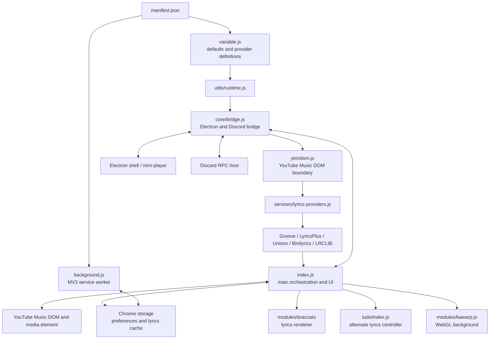

# Loop Project Map and Implementation Plan

**Repository:** `loop-mp3/loop`  
**Snapshot reviewed:** `main` at commit `749c6f1bffe999777923b1a1d233b5aebba57458`  
**Purpose:** map the current structure and propose a low-risk implementation sequence. This is a static repository review, not a runtime audit.

## Executive summary

Loop is a Manifest V3 YouTube Music extension with several substantial subsystems: player/UI integration, lyrics discovery and rendering, animated backgrounds, preferences/cache management, and integrations with an Electron shell and Discord RPC.

The main maintainability hotspot is `index.js`: approximately 6,837 lines and 304 KB in this snapshot, with roughly 219 top-level function declarations. It contains many separate domains, including cache management, provider settings, TTML/LRC parsing, lyric resolution, translation, renderer selection, background rendering, track metadata, playback lifecycle, search, queue, and bootstrap.

The repository is not uniformly monolithic. Several useful boundaries already exist: `ytm/dom.js`, `utils/runtime.js`, `core/bridge.js`, provider adapters under `services/`, and the Braccato renderer modules. The plan should extend these boundaries incrementally rather than replace the architecture wholesale.

## 1. Repository tree

```text
loop/
├── AGENTS.md
├── CHANGELOG.md
├── README.md
├── LICENSE
├── manifest.json
├── package.json
├── package-lock.json
├── index.js                       # Main content-script integration and UI (~304 KB)
├── background.js                  # MV3 service worker
├── variable.js                    # Defaults, provider registry data, shared keys
├── config/
│   ├── config.md                  # Kawarp config guide
│   ├── shader.json
│   └── presets/
│       ├── manifest.json
│       ├── core.json
│       ├── am.json
│       ├── dynamic-background-shader.json
│       ├── lucid-shader.json
│       ├── sustain-shader.json
│       └── void.json
├── core/
│   └── bridge.js                  # Electron mini-player/Kawarp + Discord message bridge
├── ytm/
│   └── dom.js                     # YouTube Music DOM selectors and metadata helpers
├── utils/
│   └── runtime.js                 # Extension URL, HTML escape, time formatting helpers
├── services/
│   ├── lyrics-providers.js        # Provider registry, dispatch, candidate fan-out
│   ├── groove.js                  # Groove adapter
│   ├── lyricsplus.js              # LyricsPlus adapter
│   ├── unison.js                  # Unison adapter
│   ├── binilyrics.js              # Binilyrics TTML/LRC adapters
│   └── lrclib.js                  # LRCLIB search, retries, candidate handling
├── modules/
│   ├── kawarp.js                  # WebGL animated background renderer
│   └── braccato/
│       ├── index.js               # Public renderer exports
│       ├── engine.js              # Per-view animation and scroll/timing engine (~140 KB)
│       ├── renderer.js            # Renderer facade/host boundary
│       ├── element.js             # Custom element integration
│       ├── inject.js              # Line building, word timing, translation/romanization
│       ├── view.js                # Rendered view construction
│       ├── stage.js               # Layout/stage calculations
│       ├── themeSettings.js       # Theme setting registration/configuration
│       ├── constants.js
│       ├── instrumental.js
│       ├── imageHighlights.js
│       ├── language.js
│       ├── seek.js
│       ├── text.js
│       ├── util.js
│       ├── types.js
│       └── styles/
│           ├── lyrics.css
│           ├── variables.css
│           ├── stage.css
│           ├── instrumental.css
│           └── image-highlights.css
├── ludo/
│   ├── index.js                   # Alternate/legacy lyrics controller entry
│   └── README.md
├── static/                        # CSS, icons, artwork and other static assets
└── tests/
    └── lrc-word-sync.test.js      # Node test exercising parser code extracted from index.js
```

## 2. Runtime loading and dependency map

The manifest loads the content scripts in this order at `document_start`:

1. `variable.js`
2. `utils/runtime.js`
3. `core/bridge.js`
4. `ytm/dom.js`
5. `services/lyrics-providers.js`
6. `services/groove.js`
7. `services/lyricsplus.js`
8. `services/unison.js`
9. `services/binilyrics.js`
10. `services/lrclib.js`
11. `index.js`

This is a classic-script/global-registration architecture, not a conventional bundled ES-module application. The earlier files publish APIs on `globalThis` (for example `LoopVariables`, `LoopUtils`, `LoopCore`, `LoopYtmDom`, and `LoopLyricsServices`), which `index.js` consumes. The Braccato directory uses ES-module imports internally but is loaded as a web-accessible resource by the main script.



The arrows describe intended/observed integration at a high level, not every message or call site. The Electron and Discord hosts are outside this repository.

## 3. Subsystem map

### A. Bootstrap, configuration and preferences

**Files:** `manifest.json`, `variable.js`, `utils/runtime.js`, and the preference-related sections of `index.js`.

Responsibilities:
- Define default preferences, Kawarp settings, provider endpoints/order and storage keys.
- Load and normalize saved preferences.
- Persist preference changes.
- Control update checks and onboarding.
- Configure the selected lyrics renderer and playback polling interval.

Important functions in `index.js` include:
- Provider settings: `getLyricsProviderDisplayOrder`, `getLyricsProviderOrder`, `saveLyricsProviderState`, `setLyricsProviderOrder`, `setLyricsProviderEnabled`, `removeLyricsProvider`, `restoreLyricsProviders`, `renderLyricsProviderPriorityUI`.
- Preference normalization: `normalizeLyricsGapNoteThreshold`, `normalizeLoopUpdateInterval`, `normalizeKawarpFpsCap`, `normalizeLyricsRenderingEngine`.
- Lifecycle/configuration: `startLoopUpdatePolling`, `getStoredLoopPreferences`, `saveLoopPreferences`, `applyLoopPreferences`, `loadLoopPreferences`.

**Boundary issue:** configuration and preference behavior is distributed between `variable.js` and `index.js`; there is no dedicated preference service. Keep defaults separate from mutable state, and define one owner for normalization/persistence before extracting code.

### B. YouTube Music integration and playback lifecycle

**Files:** `ytm/dom.js`, `index.js`.

`ytm/dom.js` owns selectors and basic extraction:
- `waitForYTM`
- `getYTMPlayerRoot`
- `getCurrentTrackId`
- artwork helpers
- `getTrackInfo`

`index.js` still owns much of the interaction/lifecycle:
- `getCurrentMedia`
- `watchPlaybackState`
- `scheduleTrackSync`
- `observeMediaTrackChanges`
- `watchTrackChanges`
- `updateForCurrentTrack`
- `updateLoop`
- playback controls and YTM shortcut dispatch

**Boundary issue:** selector isolation is a good start, but track identity, media state, polling and feature updates are still coupled in the main script. Future extraction should preserve current DOM fallbacks and event ordering.

### C. Lyrics provider discovery and resolution

**Files:** `services/lyrics-providers.js`, `services/{groove,lyricsplus,unison,binilyrics,lrclib}.js`, plus resolution/normalization code in `index.js`.

Current responsibilities:
- `variable.js`: provider metadata, endpoint URLs and default priority.
- `lyrics-providers.js`: registry and dispatch; candidate requests fan out with `Promise.all`, returning provider-tagged candidates.
- Adapter files: network requests and provider-specific response validation/conversion.
- `index.js`: common normalization helpers, title/duration validation, retries, candidate selection, manual selection UI, rendering handoff and cache interactions.

Relevant functions in `index.js`:
- `lyricsPlusToTTML`, `parseTTMLTimestamp`, `parseTTMLLyrics`, `hasSyncedLyricTimestamps`
- `lyricsDurationExceedsTrack`, `LyricsTitleMatchesTrack`, `normalizeLyricsResponse`
- `getLyricsCandidatesForAllProviders`, `getLyricsFromTrackInfo`, `getLegacyLyricsFromTrackInfo`
- `fetchLoopLyricsForCurrentTrack`, `fetchLoopLyricsForCurrentTrack`/`updateLoopLyrics` orchestration
- `showLyricsCandidateModal`, `ensureManualLyricsSelectionLink`

**Observed design tension:** the provider registry exposes both `request` and `getProviderCandidates`; adapters can implement a single request or a candidate list. LRCLIB has separate direct-request and candidate-search paths. This may be intentional, but the contracts should be made explicit so that selection, fallback and validation do not drift between paths.

### D. Lyrics parsing, cache, translation and user selection

**Files:** mostly `index.js`, plus provider adapters and the Braccato renderer.

Cache and management:
- `getLyricsCacheKey`, `getLyricsCacheStorage`, `getCachedLyrics`, `cacheLyrics`
- manual cache: `getManualLyricsCacheKey`, `getManualCachedLyrics`, `cacheManuallySelectedLyrics`
- enumeration/editing: `getAllCachedLyrics`, `getAllLyricsCacheEntries`, `saveLyricsCacheEntry`, `removeLyricsCacheEntry`, `getLyricsCacheExport`, `importLyricsCacheExport`, `showCachedLyricsModal`
- cache reset and cleanup: `removeCachedLyrics`, `restoreCachedLyrics`, `resetLoopData`

Translation:
- `normalizeLyricsTranslationLanguage`, `getTranslationCacheKey`, `isValidTranslationResult`, `getCachedTranslation`, `cacheTranslation`
- `translateLyricsLines`, `translateLyricsLinesWithRetry`, `applyTranslatedLyrics`

Lyrics view lifecycle:
- `loadBraccatoLyrics`, `updateLoopLyrics`, `fetchLoopLyricsForCurrentTrack`, `rerenderLyricsForSelectedEngine`
- TTML/LRC parsing, timestamp offsets, writer-credit normalization and gap-note helpers

**Boundary issue:** provider data, normalized lyrics, cached lyrics, manually selected lyrics, translated lines and renderer-ready data are adjacent concepts. Introduce explicit data contracts and tests before moving implementations.

### E. Braccato lyrics renderer

**Files:** `modules/braccato/*`.

- `engine.js`: animation tick, playback clock integration, line state and scroll/timing behavior.
- `renderer.js`: facade creating a renderer per view and forwarding host operations.
- `element.js`: custom element lifecycle and media clock observation.
- `inject.js`: line content, timed word parts, romanization/translation decoration.
- `view.js`: constructs rendered lyric view.
- `stage.js`: layout planning and stage positions.
- `themeSettings.js`: registered settings and parsing.
- other files: text/language helpers, seek, instrumental display, image highlights and CSS.

**Assessment:** this subsystem has clearer internal modularity and detailed ownership comments than `index.js`. Its large `engine.js` deserves its own review, but it should not be the first target unless a concrete renderer defect requires it. Avoid splitting it solely because of file size; the engine may contain tightly coupled frame-state logic.

### F. Animated backgrounds and video presentation

**Files:** `modules/kawarp.js`, configuration/presets, and `index.js`.

- `modules/kawarp.js`: WebGL shader programs, frame loop, textures/framebuffers and animation controls.
- `index.js`: lazy renderer loading, settings/preset management, canvas visibility, artwork changes, video synchronization and UI arrangement.
- `config/`: default shader config, preset registration and documentation.
- `variable.js`: Kawarp defaults and preference keys.

**Boundary issue:** rendering engine and its lifecycle/configuration UI are separated by file but still coordinated through `index.js`. Extract the controller/lifecycle only after its inputs, disposal behavior and frame ownership are tested.

### G. Electron and Discord integration

**Files:** `core/bridge.js`, `index.js`, `background.js`, plus external host code.

`core/bridge.js` owns:
- Electron Kawarp state publication
- mini-player state and commands
- Discord activity publication/clear
- signatures/throttling to reduce redundant updates

`index.js` wraps bridge calls and supplies current media, preferences and renderer state. `background.js` handles extension messages such as closing the current tab, publishing lyrics to LRCLIB, and legacy mini-player PiP behavior. The Electron host itself is not present in this repository.

**Boundary issue:** message names and state payloads are a de facto protocol. Document them and add tests for payload shape, deduplication and state transitions before changing them.

### H. UI, navigation, search and queue

**Files:** primarily `index.js` and `static/loop.css`.

Areas in the main script:
- onboarding and changelog rendering
- settings/provider-priority UI
- cache and lyric-submission modals
- main player layout, theme and track presentation
- empty-state recommendations
- queue/search panel and suggestions
- navigation, fullscreen, record and YTM action integration

**Boundary issue:** large DOM templates and feature state share the same module as media and lyric resolution. These are good candidates for extraction after tests exist around event binding, mount/unmount and duplicate-listener prevention.

### I. Background service worker

**File:** `background.js`.

Observed responsibilities:
- check for updates on extension install
- show update popup
- process `close-current-tab`
- submit lyrics to LRCLIB
- legacy `open-mini-player` picture-in-picture request

**Review item:** verify whether the legacy PiP message is still reachable and needed, and make update-check behavior explicit. Do not delete it based on a comment alone.

### J. Ludo alternate lyrics controller

**Files:** `ludo/index.js`, `ludo/README.md`, and call sites in `index.js`.

The main script tracks a `createLudoLyricsController` reference and selects between a standard and alternate lyrics rendering engine. The exact lifecycle and intended support status should be confirmed before refactoring. Preserve this path until its feature contract is documented and tested.

## 4. Main `index.js` functional regions

Approximate line ranges from the reviewed snapshot (line numbers will move as the file changes):

| Lines | Responsibility | Example functions |
|---|---|---|
| 1–480 | Shared adapters, provider settings, preference normalization and polling | `getCurrentTrackId`, `renderLyricsProviderPriorityUI`, `startLoopUpdatePolling` |
| 481–793 | Onboarding, update notices and version checks | `showOnboarding`, `checkForUpdates` |
| 793–1432 | Preferences and lyrics cache management | `saveLoopPreferences`, `cacheLyrics`, `showCachedLyricsModal` |
| 1433–1991 | Reset and lyrics submission modals | `showLoopResetModal`, `showLyricsSubmissionModal`, `resetLoopData` |
| 1992–2741 | Preference application, theme, YTM actions, miniplayer and feedback sync | `applyLoopPreferences`, `openMiniPlayer`, `syncTrackFeedbackState` |
| 2742–3415 | TTML/LRC helpers, common lyrics validation and parsing | `parseTTMLLyrics`, `normalizeLyricsResponse`, `parseSyncedLyrics` |
| 3416–4276 | Lyrics UI, translation and fetch orchestration | `loadBraccatoLyrics`, `updateLoopLyrics`, `fetchLoopLyricsForCurrentTrack` |
| 4277–4796 | Kawarp config/presets and artwork/video background lifecycle | `loadKawarpRenderer`, `showKawarpConfigEditor`, `updateVideoBackground` |
| 4797–5149 | Track metadata, writer credits and empty-state recommendations | `getTrackWritersFromBrowse`, `renderEmptyStateRecommendations` |
| 5150–6179 | Main UI update and playback lifecycle | `updateLoop`, `watchPlaybackState`, `watchTrackChanges`, `updateForCurrentTrack` |
| 6180–6837 | Search, queue, bootstrap and final helpers | `showLoopQueue`, `showLoopSearch`, `init`, `isElectron` |

These are organizational regions inferred from function order, not guaranteed isolated modules.

## 5. Risk assessment

### High priority
1. **No stable seam around `index.js`:** many responsibilities share global state and call each other directly.
2. **Lyrics pipeline contracts:** provider candidates, direct requests, normalized results, cache objects and renderer input need one documented schema.
3. **Track-change race behavior:** async provider responses, retries, cache restore and track switches must never allow stale lyrics to overwrite the current track.
4. **Limited automated tests:** the inspected test directory contains one parser-focused test file; coverage of provider selection, caching, state transitions and bridges is not established.

### Medium priority
5. **Global classic-script dependency order:** manifest ordering is part of the runtime contract.
6. **UI lifecycle:** DOM insertion, observer callbacks, timers and duplicate event listeners need predictable disposal.
7. **Cross-context message protocols:** Electron/Discord message payloads need schema and transition tests.
8. **Kawarp lifecycle:** renderer creation, resize, pause, visibility and disposal are sensitive performance paths.

### Lower priority until evidence says otherwise
9. Splitting `modules/braccato/engine.js` only because it is large.
10. Renaming files or changing folder structure for aesthetics.
11. Migrating the whole extension to a build system before the behavior is covered by tests.

## 6. Recommended target architecture

Keep the Manifest V3 content-script model for now. Create explicit modules with narrow interfaces and retain `index.js` as a thin composition/bootstrap layer during migration.

```text
index.js                     # Composition root only, eventually
├── app/
│   ├── lifecycle.js         # init/dispose, YTM readiness, page lifecycle
│   └── track-session.js     # current track identity, request generation, playback snapshot
├── player/
│   ├── controller.js        # player actions, playback controls
│   ├── view.js              # main Loop UI mounting and updates
│   └── search-queue.js      # search and queue surfaces
├── lyrics/
│   ├── contracts.js         # normalized data shape and provider interface
│   ├── resolver.js          # provider fan-out, ranking, fallback, cancellation
│   ├── normalization.js     # provider payload -> canonical lyrics
│   ├── parsers/
│   │   ├── lrc.js
│   │   └── ttml.js
│   ├── cache.js             # normal/manual cache, import/export
│   ├── translation.js       # translation cache/retry/normalization
│   ├── selection-ui.js      # candidate selection and manual override UI
│   └── render-controller.js # select Braccato/Ludo and lifecycle
├── preferences/
│   ├── schema.js            # defaults and normalization
│   └── store.js             # read/write and change notifications
├── background/
│   └── kawarp-controller.js # renderer lifecycle/settings/presets
├── integrations/
│   ├── electron.js          # typed mini-player and Kawarp message protocol
│   └── discord.js           # activity protocol/deduplication
├── ytm/dom.js               # existing selector boundary
├── core/bridge.js           # existing bridge, or split by transport later
├── services/                # provider-specific adapters
└── modules/                 # Braccato/Kawarp implementation
```

This is a target, not a request to create every file immediately. Use the existing folder names where possible and avoid unnecessary path churn.

## 7. Implementation map: phased, low-risk migration

### Phase 0 — Establish a baseline
- [ ] Record the current `main` commit and create a dedicated refactor branch.
- [ ] Run `npm test` and capture the current result.
- [ ] Manually verify a smoke-test checklist: initial load, playback, track change, pause/seek, lyrics load, cache restore, provider order, manual lyric selection, translation, Braccato/Ludo switch, background enable/disable, miniplayer state, Discord activity, search and queue.
- [ ] Capture browser console and service-worker errors.
- [ ] Document known existing bugs rather than fixing them during extraction.

**Exit criteria:** baseline behavior is recorded; no unrelated feature changes are mixed into the refactor.

### Phase 1 — Protect pure logic with tests
- [ ] Extract the TTML/LRC parsing helpers from `index.js` into standalone pure modules without changing behavior.
- [ ] Change `tests/lrc-word-sync.test.js` to import the actual parser module instead of slicing function text out of `index.js`.
- [ ] Add tests for timestamp formats, malformed input, whitespace preservation, XML entities, word timestamps, line-only LRC and TTML paragraphs.
- [ ] Add unit tests for `normalizeLyricsResponse`, duration rejection and provider ordering.
- [ ] Add tests for cache key generation and translation cache validation.

**Exit criteria:** existing parser tests pass against imported production code; pure logic has regression coverage.

### Phase 2 — Make the lyrics pipeline explicit
- [ ] Define a canonical `LyricsResult` contract: provider ID, metadata, synced text, plain text, instrumental flag, duration and optional writer credits.
- [ ] Define a provider adapter contract that explicitly distinguishes single-result resolution from candidate discovery.
- [ ] Move normalization and result validation out of `index.js` into `lyrics/normalization.js`.
- [ ] Move provider fan-out, ordering, cancellation and stale-response protection into `lyrics/resolver.js`.
- [ ] Keep provider adapters in `services/`; adapters should fetch and convert provider-specific payloads, not own UI/cache decisions.
- [ ] Centralize track request generation/cancellation so responses for a previous song cannot replace lyrics for the current song.
- [ ] Make direct resolution and candidate selection share validation and normalization rules.
- [ ] Add deterministic tests using mocked `fetch` for provider failure, empty response, slow provider, cancellation, fallback and candidate selection.

**Exit criteria:** one documented route from provider response to validated candidate to chosen lyrics, with consistent error/fallback behavior.

### Phase 3 — Extract cache and translation
- [ ] Move normal/manual lyrics cache operations to `lyrics/cache.js`.
- [ ] Keep UI modals separate from storage functions.
- [ ] Move translation request/retry and translation-cache validation to `lyrics/translation.js`.
- [ ] Add import/export validation and versioning before changing the persisted cache format.
- [ ] Add migration tests if storage keys or stored shapes change.

**Exit criteria:** storage is independently testable; cache format remains backward-compatible unless an explicit migration is added.

### Phase 4 — Split UI from feature logic
- [ ] Extract provider-priority UI and settings modal rendering from provider state logic.
- [ ] Extract cached-lyrics and manual-selection modals from cache/resolver functions.
- [ ] Extract search/queue panels into `player/search-queue.js`.
- [ ] Extract main UI mounting/update functions into `player/view.js`.
- [ ] Make each feature own its event listeners and provide a `dispose()` path for observers/timers/listeners.
- [ ] Avoid rewriting DOM templates or styling in the same change as moving code.

**Exit criteria:** UI modules consume controller/service APIs instead of directly mutating unrelated subsystem state.

### Phase 5 — Track and playback lifecycle
- [ ] Define a small track-session state shape (track ID, metadata, duration, playback status, request generation).
- [ ] Make one component the owner of current track transitions.
- [ ] Route lyric fetches, artwork changes, video presentation, mini-player state and Discord activity from explicit state updates.
- [ ] Add tests for rapid track switching, pause/seek, duplicate events and stale async completion.
- [ ] Keep YTM selectors in `ytm/dom.js`; do not scatter new selectors back across the project.

**Exit criteria:** one clear place owns track identity and transition ordering.

### Phase 6 — Integrations and background lifecycle
- [ ] Document message types and payload schemas for Electron and Discord.
- [ ] Split bridge code by transport only if that makes ownership clearer.
- [ ] Test state deduplication, forced publication, pause/resume and missing host.
- [ ] Verify the legacy PiP message is still used before removing it.
- [ ] Audit update popup flow and extension permissions; keep host permissions least-privilege where feasible.
- [ ] Test Kawarp renderer create/update/dispose and visibility transitions.

**Exit criteria:** integration protocols are documented and background/rendering lifecycles have explicit cleanup.

### Phase 7 — Reduce the composition root
- [ ] Move remaining cohesive feature areas from `index.js` into their target modules.
- [ ] Keep `index.js` responsible for dependency wiring and `init()` rather than implementation details.
- [ ] Update `manifest.json` script ordering whenever new classic scripts are introduced.
- [ ] Add a short architecture section to `AGENTS.md` so coding agents know the ownership boundaries.
- [ ] Consider ES modules/build tooling only as a separate project after the current runtime contract is stable.

**Exit criteria:** `index.js` is primarily bootstrap/composition and no longer owns parser, cache, resolver, UI, and background implementation.

## 8. Rules for agents during migration

Put these constraints in every refactor task:
1. No feature changes; preserve visible behavior and preference/storage formats.
2. One subsystem per PR/commit.
3. No bulk rewrite or mass renaming.
4. Inspect callers before changing a function signature.
5. Keep provider priority and fallback semantics unchanged unless separately specified.
6. Keep existing manifest load order valid.
7. Do not alter Electron message names or payload shapes without updating protocol tests.
8. Add tests before moving pure logic.
9. Run `npm test` after each step and report manual tests not run.
10. If behavior is unclear, document the uncertainty instead of inventing intended behavior.

## 9. First three implementation tasks

### Task 1 — Parser extraction (lowest risk, immediate value)
**Scope:** `parseTTMLTimestamp`, `parseTTMLLyrics`, `parseSyncedLyrics`, and directly required pure helpers.

Deliverables:
- Parser module(s) imported by production code.
- Existing tests importing the parser module directly.
- Expanded parser edge-case tests.
- No rendering or provider behavior changes.

### Task 2 — Lyrics normalization contract
**Scope:** `normalizeLyricsResponse`, duration/title checks and provider-result shape.

Deliverables:
- Documented canonical result schema.
- Unit tests for provider result variants.
- Adapters unchanged except for contract alignment needed to pass tests.

### Task 3 — Resolver and stale-response protection
**Scope:** candidate fan-out, provider priority, cancellation and per-track request generation.

Deliverables:
- One resolver module.
- Tests for provider errors, empty results, delayed results, fallback and track changes.
- No UI changes.

**Do not start with** the 140 KB Braccato engine or a full rewrite of `index.js`. Start with pure logic and observable boundaries.

## 10. Verification gaps and caveats

- This map was created from the public repository snapshot and selected source files; the extension was not executed in a browser.
- The external Electron host and hosted provider implementations are not part of this repository.
- The existence of `ludo/index.js` and a Ludo controller reference is visible, but its current support contract should be confirmed before any deprecation.
- `package.json` defines `node --test`; the inspected tree includes `tests/lrc-word-sync.test.js`. Test coverage beyond that file was not established.
- Manifest permissions, including `<all_urls>`, deserve a security/least-privilege review. This is a review item, not a claim of a confirmed vulnerability.
- Any line numbers, file sizes and tree details can change after new commits.

## Source links

- Repository: https://github.com/loop-mp3/loop
- Manifest: https://github.com/loop-mp3/loop/blob/main/manifest.json
- Main script: https://github.com/loop-mp3/loop/blob/main/index.js
- Shared defaults: https://github.com/loop-mp3/loop/blob/main/variable.js
- YouTube Music DOM boundary: https://github.com/loop-mp3/loop/blob/main/ytm/dom.js
- Provider registry: https://github.com/loop-mp3/loop/blob/main/services/lyrics-providers.js
- Braccato renderer engine: https://github.com/loop-mp3/loop/blob/main/modules/braccato/engine.js
- Test: https://github.com/loop-mp3/loop/blob/main/tests/lrc-word-sync.test.js
